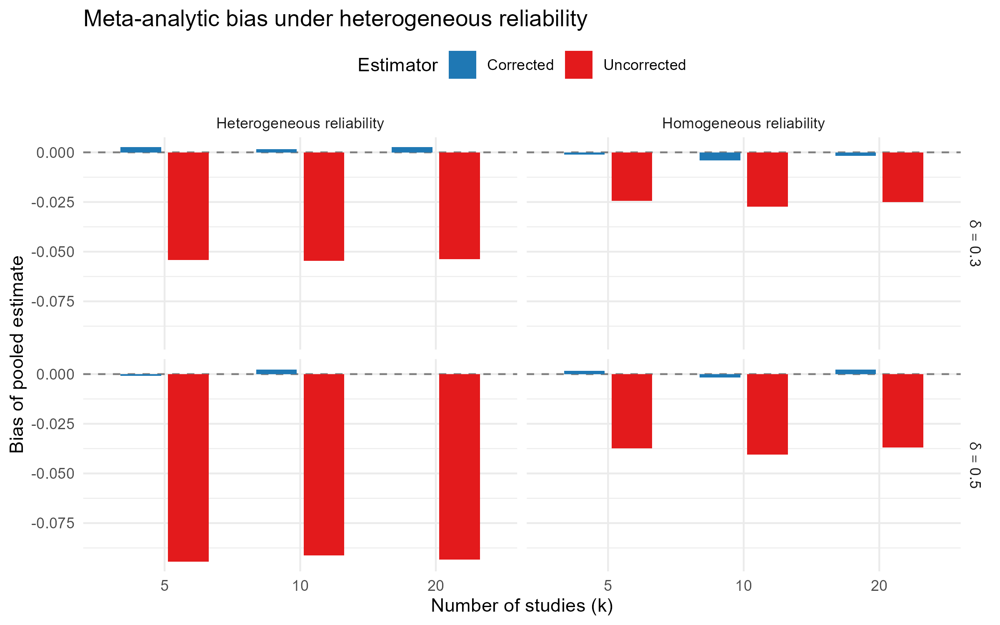

*Not: Bu belge, İngilizce ana metnin çalışma amaçlı Türkçe çevirisidir;
dergiye gönderilecek metin İngilizce sürümdür.*

# Öz

Gözlenen etki büyüklükleri, puan güvenirliğinin kusurlu olması
nedeniyle zayıflar (attenuation); ancak bu yanlılık araştırma
pratiğinde nadiren düzeltilir. Bu çalışmada; Cohen *d*'sini, Hedges
*g*'sini ve Pearson korelasyonlarını klasik test kuramı çerçevesinde
güvenirsizliğe göre düzelten, Hunter--Schmidt, Bonett, yanlılık
düzeltmeli hızlandırılmış bootstrap ve Fisher-z aralık yöntemleri
ile güvenirlik-kestirim belirsizliğinin isteğe bağlı yayılımını
sunan measuredES R paketini tanıtıyoruz. Paketi ve düzeltmenin kendisini
değerlendirmek için, düzeltilmiş ve düzeltilmemiş Cohen *d*'sinin
yanlılığını, hata kareleri ortalamasının karekökünü (RMSE) ve güven
aralığı kapsamasını gerçek etki büyüklüğü, örneklem büyüklüğü,
güvenirlik, dağılım biçimi ve güvenirliğin bilinmesi--kestirilmesi
koşulları boyunca inceleyen 192 hücreli faktöriyel bir Monte Carlo
simülasyonu (hücre başına 5.000 tekrar) yürüttük. İkinci bir
simülasyon (hücre başına 1.000 tekrar), çalışmalar arası güvenirlik
heterojenliğinin havuzlanmış meta-analitik kestirimlere etkisini
inceledi; altı odaklı alt-çalışma ise değerlendirmeyi bootstrap
aralığına, şiddetli çarpıklığa, güvenirlik-kestirim belirsizliğine,
birleşik Behrens--Fisher durumu dahil dengesiz ve değişen varyanslı
desenlere, korelasyonlar için iki yönlü düzeltmeye ve düzeltilmiş
korelasyonların meta-analitik havuzlanmasına genişletti. Düzeltilmemiş etki büyüklükleri evren etkisini
$\sqrt{\rho_{xx}}$ ile orantılı biçimde küçümsedi ($\rho_{xx} = .60$
düzeyinde yaklaşık %22); her iki analitik aralık da nominal düzeye
yakın kapsama sağladı; Hunter--Schmidt aralığı hafifçe
anti-konservatif, Bonett aralığı ise küçük örneklemlerde hafifçe
konservatif yönde saptı; heterojen güvenirlikli çalışmaların
meta-analizleri, her çalışma tek tek düzeltilmedikçe aşağı yönlü
yanlı kaldı ve havuzlanmış kestirimin kapsaması $k = 20$ çalışmada
*d* için 0.28'e (korelasyonlar için 0.00'a) kadar düştü. Her çalışmanın
tek tek düzeltilmesi *d* için kapsamayı neredeyse nominal düzeye
geri getirdi; havuzlanmış korelasyonlarda ise kapsama yalnızca
0.88--0.92 aralığına ulaştı. Bu sonuçların raporlama pratiği ve meta-analitik
sentez için ne anlama geldiğini ve düzeltmenin uygulamalı
çalışmalarda hangi koşullarda savunulabilir olduğunu tartışıyoruz.

**Anahtar sözcükler:** etki büyüklüğü, ölçme hatası, güvenirlik,
zayıflama, Cohen d'si, Hedges g'si, meta-analiz, simülasyon
çalışması, R yazılımı

# 1. Giriş

Standartlaştırılmış etki büyüklüklerinin raporlanması, davranış
bilimlerinde neredeyse evrensel bir beklenti hâline gelmiş; *Amerikan
Psikoloji Birliği Yayım Kılavuzu*'nda [@apa2020] kurallaştırılmış ve
psikoloji, eğitim ve daha geniş sosyal bilimlerdeki editoryal
politikalara yerleşmiştir [@wilkinson1999; @cumming2014]. Etki
büyüklükleri bir olgunun büyüklüğünü çalışmalar arasında
karşılaştırılabilir bir metrikte ifade eder, güç analizini ve
araştırma planlamasını besler ve meta-analitik sentezin ham maddesini
sağlar. Etki büyüklüğü raporlaması bu nedenle "yeni istatistik"
reform hareketinin merkezinde yer almış [@cumming2014]; güncel
editoryal zorunluluklar raporlamanın ötesine geçerek aralık
kestirimi ve içerikli yorum talep eder olmuştur [@apa2020].

Ne var ki temel bir psikometrik sorun bu reformun büyük ölçüde
kıyısında kalmıştır: hatalı ölçme araçlarından hesaplanan
standartlaştırılmış etki büyüklükleri, ilgilenilen yapıya ilişkin
evren etkisine göre sistematik biçimde zayıflar. Spearman
[-@spearman1904] tarafından formalize edilen bu zayıflama, klasik
test kuramının doğrudan bir sonucudur: gözlenen puan $X$, gerçek puan
$T$ ile bağımsız rastgele hata $E$'nin toplamı olduğunda $X$'in
varyansı $T$'nin varyansını aşar ve $X$ üzerindeki her
standartlaştırılmış karşılaştırma sıfıra doğru büzülür.
Standartlaştırılmış ortalama farkı için bu ilişki şu biçimi alır:

$$d_{\text{gözlenen}} = d_{\text{gerçek}} \cdot \sqrt{\rho_{xx}}$$

Burada $\rho_{xx}$, bağımlı değişkenin güvenirliğidir. Aynı mantık,
her iki değişkendeki hatanın büzülmeyi katladığı korelasyon
katsayıları için de geçerlidir [@spearman1904].

Bu zayıflamanın pratik sonuçları göz ardı edilebilir düzeyde
değildir. Schmidt ve Hunter [-@schmidt1996], ölçme hatasını yok
saymanın sonuçlarını personel seçiminden eğitsel değerlendirmeye ve
klinik ölçmeye uzanan 26 araştırma senaryosu üzerinde izlemiş ve
düzeltilmemiş etki kestirimlerinin sistematik olarak yanıltıcı
içerik sonuçları ürettiğini göstermiştir. Hunter ve Schmidt
[-@hunter2004], zayıflama düzeltmesi mantığını, gözlenen etki
büyüklüklerinin sentez öncesinde örnekleme hatası, ranj daralması ve
güvenirsizlik için düzeltildiği ve kimi zaman "psikometrik
meta-analiz" olarak adlandırılan bütün bir meta-analiz yaklaşımının
temeli yapmıştır. Baugh [-@baugh2002], puan güvenirliğine göre
düzeltilmiş etki büyüklüklerinin rutin olarak raporlanmasının eğitimde
ve psikolojide ölçme alanında standart uygulama hâline gelmesi
gerektiğini savunmuştur; bu makale o savı çıkış noktası olarak alır.

## 1.1 Yöntembilimsel uzlaşı ile yazılım desteği arasındaki boşluk

Ölçme hatasına göre düzeltilmiş etki büyüklüklerinin yöntembilimsel
gerekçesi ne yenidir ne de tartışmalıdır. Spearman düzeltmesi bir
yüzyılı aşkın süredir ders kitabı düzeyinde bir işlemdir ve Hunter ile
Schmidt'in psikometrik meta-analiz çerçevesi endüstri-örgüt
psikolojisinde, eğitimde ve ilgili alanlarda binlerce uygulama
biriktirmiştir. Yöntembilimsel uzlaşıya ayak uyduramayan şey,
düzeltilmiş kestirimlerin uygulamalı çalışmalarda rutin olarak
erişilebilir olmasıdır. Bu saptamayı iki gözlem destekler.

Birincisi, R ekosistemindeki yaygın genel amaçlı etki büyüklüğü
paketleri güvenirlik düzeltmesini varsayılan olarak sunmaz. Yaygın
kullanılan `effectsize` paketi [@bensh2020] Cohen *d*'sini, Hedges
*g*'sini ve pek çok başka indeksi hesaplar; ancak ölçme hatası
düzeltmesini çekirdek işlevleri arasında sunmaz. Uzmanlaşmış paketler
sorunun dar bileşenlerini kapsar: `MBESS` [@kelley2007] çeşitli etki
büyüklükleri için güven aralıkları sağlar, `psych` [@revelle2024]
$\omega$ katsayısı dahil güvenirlik katsayılarını hesaplar ve
`metafor` [@viechtbauer2010] meta-analitik sentez yürütür. En yakın
akraba, `correct_d()` işleviyle *d* için güvenirsizlik düzeltmeleri
dahil Hunter--Schmidt artefakt düzeltmelerini psikometrik
meta-analiz makinesinin parçası olarak sunan `psychmeta`
[@dahlke2019] paketidir. `psychmeta` meta-analitik veri tabanlarına
yöneliktir: `correct_d()` önceden hesaplanmış *d* değerlerini alır,
düzeltmeyi nokta-çiftserili korelasyona dönüştürme yoluyla elde eder
ve burada değerlendirilen değişen-varyansa-dayanıklı ya da bootstrap
aralıklarını sunmaz. Ham veriden, formülden ya da özet
istatistiklerden düzeltilmiş bir *d*-ailesi kestirimi hesaplamayı
aralık kestirimi ve meta-analitik dışa aktarımla birleştiren,
tek-çalışma iş akışına hizmet eden bir paket yoktur.

İkincisi, düzeltmelerin rutin uygulanması, uygulamalı
araştırmacıların yazılım desteği olmadan kolayca veremeyeceği
kararlar gerektirir. Klasik Spearman düzeltmesi bir nokta kestirimi
verir ama kendi başına bir aralık kestirimi sağlamaz; standart
Hunter--Schmidt güven aralığı [@hunter2004] güvenirliği biliniyormuş
gibi ele alır ve güvenirlik kötü kestirildiğinde nominalin altında
kapsayabilir [@charles2005]; Bonett'in *t* dağılımı iyileştirmesi
[@bonett2008] ve bootstrap yöntemleri [ayrıca bkz. @algina2003]
seçenek sunar; ancak bunların gerçekçi koşullardaki göreli
performansı sistematik olarak haritalanmamıştır. Bunun sonucunda,
zayıflama düzeltmesi uygulayan az sayıdaki araştırmacı bunu çoğu kez
aralık kestirimi olmaksızın yapar; bu da düzeltmenin çıkarımsal
değerini sınırlar.

## 1.2 Bu çalışmanın katkısı

Bu boşluğu, ölçme hatasına göre düzeltilmiş etki büyüklüklerini
klasik test kuramı çerçevesinde uygulayan measuredES R paketini
tanıtarak ele alıyoruz. Paket; Cohen *d*'si, Hedges *g*'si ve
Pearson korelasyonlarının (sonuncusu Fisher-z aralığıyla)
düzeltilmiş sürümlerini, *d* ailesi için üç güven aralığı yöntemini
(Hunter--Schmidt analitik, Bonett ve BCa bootstrap), `rxx_se`
argümanıyla güvenirlik-kestirim belirsizliğinin isteğe bağlı
yayılımını, APA-7 raporlama arayüzünü ve doğrudan `metafor`'a akan
meta-analitik dışa aktarımı sağlar. Uygulama tek-işlevli iş akışlarını önceler; ham
verinin yanı sıra özet istatistikleri de kabul eder ve bir kılavuz
(vignette) ile yeniden üretilebilir bir test takımıyla birlikte
gelir.

Hem paketi hem de düzeltme yaklaşımının kendisini değerlendirmek
için, bu makalede sunulan birbirine bağlı üç Monte Carlo simülasyon
çalışması ile altı odaklı alt-çalışma yürüttük. **Çalışma 1**, gerçek etki büyüklüğü, örneklem
büyüklüğü, gerçek güvenirlik, güvenirlik kestirim durumu (biliniyor
ya da $\alpha$ katsayısıyla kestiriliyor) ve dağılım biçiminin
(normal ya da orta düzeyde çarpık) çaprazlandığı 192 hücreli
faktöriyel desende, düzeltilmiş ve düzeltilmemiş Cohen *d*'sinin
yanlılığını ve RMSE'sini inceledi. **Çalışma 2**, iki analitik güven
aralığı yönteminin (Hunter--Schmidt ve Bonett) kapsama olasılığını
ve genişliğini aynı desen faktörleri boyunca değerlendirdi; tam
faktöriyel için fazla maliyetli olan BCa bootstrap, odaklı bir
alt-çalışmada değerlendirildi (Bölüm 5.2.4). **Çalışma 3**, analizi
meta-analitik
düzeye taşıyarak havuzlanmış etki kestirimlerinin yanlılığını,
çalışmalar arası güvenirliğin homojen ve heterojen olduğu koşullarda
ve sentezlenen çalışma sayısı $k \in \{5, 10, 20\}$ iken inceledi.
Alt-çalışmalar (Bölüm 4.5--4.6) BCa bootstrap'ı, şiddetli
çarpıklığı, güvenirlik-kestirim belirsizliğinin yayılmasını,
birleşik Behrens--Fisher durumu dahil dengesiz ve değişen varyanslı
desenleri, korelasyonlar için iki yönlü düzeltmeyi ve düzeltilmiş
korelasyonların meta-analitik havuzlanmasını yokladı.

Makalenin kalanı şöyle düzenlenmiştir. Bölüm 2 kuramsal temeli
geliştirir: Spearman düzeltmesi ve üzerine kurulan güven aralığı
yöntemleri. Bölüm 3 `measuredES` paketini tanıtır. Bölüm 4 simülasyon
desenini betimler; Bölüm 5 üç çalışmanın sonuçlarını raporlar. Bölüm
6 doğurguları, uygulama önerilerini ve sınırlılıkları tartışır; Bölüm
7 sonuçlandırır.

# 2. Kuramsal Arka Plan

## 2.1 Klasik Test Kuramı ve Spearman Düzeltmesi

Klasik test kuramı (KTK) çerçevesinde gözlenen puan $X$ şu biçimde
ayrışır:

$$X = T + E,$$

Burada $T$ gerçek puan, $E$ rastgele ölçme hatasıdır;
$\text{Cov}(T, E) = 0$ ve $E(E) = 0$ varsayılır [@lord1968]. $X$'in
güvenirliği, gerçek puan varyansının toplam gözlenen puan varyansına
oranı olarak tanımlanır:

$$\rho_{xx} = \frac{\sigma^2_T}{\sigma^2_X} = \frac{\sigma^2_T}{\sigma^2_T + \sigma^2_E}.$$

$\sigma^2_E > 0$ olduğu her durumda $\sigma^2_X > \sigma^2_T$
olduğundan, gözlenen standart sapma $S_X$ gerçek puan standart
sapması $\sigma_T$'yi aşar. Paydasında $S_X$ kullanan her
standartlaştırılmış etki büyüklüğü, bu nedenle örtük yapıya ilişkin
evren etkisine göre zayıflamıştır.

Spearman [-@spearman1904], gözlenen kestirimi güvenirliğin
karekökuna bölerek evren etkisini kestiren genel zayıflama
düzeltmesini türetmiştir:

$$\hat{\delta} = \frac{d_{\text{gözlenen}}}{\sqrt{\rho_{xx}}},$$

Burada $\delta$ gerçek-puan standartlaştırılmış ortalama farkını,
$d_{\text{gözlenen}}$ ise hatalı puanlardan hesaplanan alışıldık
Cohen $d$'sini gösterir. Düzeltme, $\rho_{xx}$ bilindiğinde kesindir;
uygulamada $\rho_{xx}$ çoğunlukla Cronbach $\alpha$'sıyla kestirilir
[@revelle2009; @mcneish2018] ve bu, Bölüm 2.3.4'te tartışılan ek bir
belirsizlik kaynağı doğurur.

## 2.2 *d*-Ailesi Etki Büyüklükleri için Düzeltme

Gerçek puan varyansları eşit iki bağımsız grup için gözlenen
puanlara dayalı Cohen $d$'si şu eşitliği sağlar:

$$d_{\text{göz}} = \frac{\bar{X}_1 - \bar{X}_2}{S_p},$$

Burada $S_p$ birleştirilmiş standart sapmadır. Paralel testler modeli
altında [@lord1968] $d_{\text{göz}}$'ün beklenen değeri yaklaşık
olarak $\delta\sqrt{\rho_{xx}}$'tir; dolayısıyla Spearman
düzeltmeli kestirici

$$\hat{\delta} = \frac{d_{\text{göz}}}{\sqrt{\hat{\rho}_{xx}}}$$

$\hat{\rho}_{xx}$, $\rho_{xx}$ için yansız olduğunda $\delta$ için
yaklaşık yansızdır [@hunter2004; @charles2005].

Hedges $g$'si [@hedges1981], $d_{\text{göz}}$'ün kendi evren
karşılığı $\delta\sqrt{\rho_{xx}}$'e göre taşıdığı küçük örneklem
kaynaklı yukarı yönlü yanlılığı gidermek için
$J(\nu) = 1 - 3/(4\nu - 1)$ küçük örneklem düzeltme çarpanını
uygular ($\nu = n_1 + n_2 - 2$):

$$g = J(\nu) \cdot d_{\text{göz}}.$$

Ölçme hatasına göre düzeltilmiş sürüm ise şudur:

$$g^* = \frac{g}{\sqrt{\rho_{xx}}}.$$

Bağımsız değişkenin de hatalı ölçüldüğü uygulamalarda (ör. regresyon
bağlamında örtük bir yordayıcı) korelasyon için tam iki yönlü
Spearman düzeltmesi geçerlidir:

$$r_{\text{gerçek}} = \frac{r_{xy}}{\sqrt{\rho_{xx} \cdot \rho_{yy}}},$$

Burada $\rho_{xx}$ ve $\rho_{yy}$ iki değişkenin güvenirlikleridir
[@hunter2004].

## 2.3 Güven Aralığı Türetimi

### 2.3.1 Hunter--Schmidt Analitik Aralığı

Gözlenen Cohen $d$'sinin örnekleme varyansı şu biçimde yaklaşıklanır
[@hedges1985]:

$$\widehat{\text{Var}}(d_{\text{göz}}) =
  \frac{n_1 + n_2}{n_1 n_2} + \frac{d_{\text{göz}}^2}{2(n_1 + n_2)}.$$

$\rho_{xx}$ sabit ve bilinir kabul edildiğinde, düzeltilmiş kestirici
$\hat{\delta} = d_{\text{göz}}/\sqrt{\rho_{xx}}$'in varyansı

$$\widehat{\text{Var}}(\hat{\delta}) =
  \frac{\widehat{\text{Var}}(d_{\text{göz}})}{\rho_{xx}}$$

olur. $(1-\alpha)$ güven aralığı, standart normal yaklaşımdan elde
edilir [@hunter2004]:

$$\hat{\delta} \pm z_{\alpha/2}
  \sqrt{\widehat{\text{Var}}(\hat{\delta})}.$$

### 2.3.2 Bonett İyileştirmesi

Bonett [-@bonett2008], varyans homojenliği varsaymak yerine her
grubun kendi varyansını kullanan, standartlaştırılmış ortalama
karşılaştırmaları için değişen-varyansa-dayanıklı bir örnekleme
varyansı türetmiştir:

$$\widehat{\text{Var}}(d) =
  \frac{d^2 \left( s_1^4/v_1 + s_2^4/v_2 \right)}
       {2 \left( s_1^2 + s_2^2 \right)^2} +
  \frac{s_1^2/v_1 + s_2^2/v_2}{\left( s_1^2 + s_2^2 \right)/2},$$

Burada $v_i = n_i - 1$'dir. `measuredES` uygulaması bu varyansı,
Hunter--Schmidt aralığında olduğu gibi $\rho_{xx}$'e böler ve
$z_{\alpha/2}$ yerine $\nu = n_1 + n_2 - 2$ serbestlik dereceli
$t_{\alpha/2,\nu}$ kritik değeriyle eşler. İki uyarı geçerlidir.
Birincisi, Bonett bu varyansı $\sqrt{(s_1^2 + s_2^2)/2}$ ile
standartlaştırılan bir karşılaştırma için türetir; `measuredES` ise
birleştirilmiş standart sapmayla standartlaştırır. İki
standartlaştırıcı $n_1 = n_2$ olduğunda çakışır; Bölüm 4'te simüle
edilen dengeli durum budur. İkincisi, grup büyüklükleri ve varyanslar
eşitken Bonett ve Hunter--Schmidt varyansları çakışır; bu durumda iki
aralık yalnızca $t$ kritik değeriyle ayrışır. Bölüm 5'teki simülasyon
sonuçlarımız, bu aralığın grup başına $n = 30$'da bile nominale yakın
kapsama sağladığını göstermektedir.

### 2.3.3 Bootstrap Aralığı

Ham veri girdileri için `measuredES`, yanlılık düzeltmeli ve
hızlandırılmış (BCa) bootstrap güven aralığı da sunar [@efron1987].
BCa aralığı dağılım varsayımı yapmaz ve bu nedenle evren dağılımı
çarpık olduğunda doğal adaydır. Hesaplama maliyeti onu tam
faktöriyelin dışında bırakır; ancak odaklı bir alt-çalışma (Bölüm
4.5 ve 5.2.4), varsayımsız kuruluşunun tam da işe yaraması beklenen
koşullarda onu analitik aralıklarla karşılaştırmaktadır.

### 2.3.4 Sınırlılık: Güvenirlik Kestirim Belirsizliği

Yukarıda betimlenen her üç aralığın da kritik bir sınırlılığı,
$\rho_{xx}$'i bilinen bir sabit olarak ele almalarıdır. Uygulamada
neredeyse her zaman olduğu gibi $\rho_{xx}$ kestirildiğinde,
$\hat{\rho}_{xx}$'in örnekleme değişkenliği $\hat{\delta}$'ya
aralıkların yakalamadığı ek bir belirsizlik katar. $d_{\text{göz}}$
ile $\hat{\rho}_{xx}$'i bağımsız kabul eden birinci dereceden bir
hata yayılımı (delta yöntemi) argümanı, eksik olanı gösterir:

$$\text{Var}(\hat{\delta}) \approx
  \frac{\text{Var}(d_{\text{göz}})}{\rho_{xx}} +
  \frac{d_{\text{göz}}^2 \, \text{Var}(\hat{\rho}_{xx})}{4\rho_{xx}^{3}}.$$

İkinci terim yalnızca $\rho_{xx}$ bilindiğinde sıfırlanır. Charles
[-@charles2005], bu ihmal edilen terimin $\hat{\rho}_{xx}$ küçük
örneklemlerden kestirildiğinde ya da gerçek güvenirlik düşük
olduğunda önemli boyutlara ulaşabileceğini göstermiştir. `measuredES`
bu düzeltmeyi uygular: güvenirlik kestiriminin standart hatası
`rxx_se` argümanıyla verildiğinde, yukarıdaki delta-yöntemi terimi
`mes_d()` ve `mes_g()`'nin analitik varyanslarına eklenir ve aralık
buna göre genişler. Bölüm 4 ve 5'te raporlanan simülasyon çalışması,
güvenirliğin bilindiği ve kestirildiği koşulları karşılaştırarak
temel öngörüyü görgül olarak sınamaktadır.

# 3. measuredES Paketi

## 3.1 Tasarım Felsefesi

`measuredES` üç ilke etrafında tasarlanmıştır. Birincisi, *varsayılan
olarak doğruluk*: her etki büyüklüğü işlevi hem düzeltilmemiş hem de
düzeltilmiş kestirimi döndürür; böylece düzeltme, isteğe bağlı bir
art-işlem adımında gizlenmek yerine çıktının içinde görünür olur.
İkincisi, *birleşik arayüz*: tek bir S3 sınıfı (`mes`), hangi etki
büyüklüğü türü hesaplanırsa hesaplansın tutarlı `print`, `summary`,
`plot` ve `as.data.frame` yöntemleri sağlar. Üçüncüsü, *iş akışı
uyumluluğu*: çıktı, meta-analiz için `metafor`'a [@viechtbauer2010]
ve makale raporlaması için APA-7 biçimli metne doğrudan akar.

Paket, mevcut R ekosistemindeki bir boşluğu ele alır. `effectsize`
[@bensh2020] temiz çıktılı ve APA raporlamalı kapsamlı bir etki
büyüklüğü işlev takımı sunar ama ölçme hatası düzeltmesi içermez.
`MBESS` [@kelley2007] etki büyüklükleri için merkezî-olmayan
dağılımlara dayalı güven aralıkları sağlar ama Spearman düzeltmesini
uygulamaz. `psych` [@revelle2024] psikometrik araç takımının parçası
olarak korelasyonlar için tek yönlü zayıflama düzeltmesini destekler
ama bunu standartlaştırılmış ortalama farklarına genişletmez.
`psychmeta` [@dahlke2019] önceden hesaplanmış *d* değerlerini
Hunter--Schmidt meta-analiz çerçevesi içinde güvenirsizliğe göre
düzeltir; `measuredES` onu birincil çalışma düzeyinde tamamlar: girdi
ham veri, formül ya da özet istatistiklerdir; çıktı ise analitik ya
da bootstrap aralık seçenekli düzeltilmiş bir kestirim, APA-7 metni
ve `metafor`'a hazır bir dışa aktarımdır.

## 3.2 Temel İşlev Haritası

Paket, kullanıcıya dönük yedi işlev dışa aktarır:

| İşlev | Açıklama |
|---|---|
| `mes_d()` | Zayıflamaya göre düzeltilmiş Cohen $d$'si: $d^* = d / \sqrt{\rho_{xx}}$ |
| `mes_g()` | Hem küçük örneklem hem zayıflama düzeltmeli Hedges $g$'si: $g^* = J \cdot d / \sqrt{\rho_{xx}}$ |
| `mes_r()` | Tek ya da iki yönlü güvenirsizliğe göre düzeltilmiş korelasyon, Fisher-z aralığıyla |
| `disattenuate()` | $d$-ailesi etki büyüklükleri ve korelasyonlar için genel düzeltme motoru |
| `mes_ci()` | Mevcut bir `mes` nesnesinin güven aralığını farklı bir yöntemle yeniden hesaplar |
| `mes_meta()` | `mes` nesnelerini `metafor` uyumlu biçime ($y_i$, $v_i$) dönüştürür |
| `mes_report()` | Bir `mes` nesnesinden APA-7 biçimli satır içi metin üretir |

`disattenuate()`, tüm düzeltme işlevlerinin altında yatan matematiksel
motordur ve kullanıcıların paket dışında hesaplanmış etki
büyüklüklerine düzeltme uygulaması gerektiğinde doğrudan
çağrılabilir.

## 3.3 Tipik İş Akışı

`measuredES` ile tipik bir araştırma iş akışı üç adımda ilerler.

**Adım 1: Düzeltilmiş etki büyüklüğünü hesapla.**

```r
library(measuredES)

# Ham veriden
result <- mes_d(x1 = kontrol_puanlari,
                x2 = deney_puanlari,
                rxx = 0.85)

# Ya da özet istatistiklerden (ör. yayımlanmış bir makale)
result <- mes_d(means = c(50, 56),
                sds   = c(10, 11),
                ns    = c(80, 75),
                rxx   = 0.78)
```

`ci_method` aracılığıyla üç güven aralığı yöntemi kullanılabilir:
`"hunter_schmidt"` (varsayılan), `"bonett"` ve `"bootstrap"` (BCa;
ham veri gerektirir).

İki değişkenli korelasyonlar için arayüz daha yalındır: gözlenen
Pearson *r* değeri, örneklem büyüklüğü ve bir ya da her iki
güvenirlik katsayısı doğrudan argüman olarak verilir.

```r
# Tek yönlü düzeltme (yalnızca ölçüt güvenirliği)
r_result <- mes_r(r = 0.42, n = 120, rxx = 0.85)

# İki yönlü düzeltme (her iki değişken de hatalı ölçülmüş)
r_result <- mes_r(r = 0.42, n = 120, rxx = 0.85, ryy = 0.78)
```

`mes_r()` her zaman Fisher-z güven aralığı döndürür; düzeltilmiş
korelasyonlar için standart ve analitik olarak uygulanabilir tek
yöntem Fisher-z dönüşümü olduğundan `ci_method` argümanına gerek
yoktur.

`rxx` argümanı, ölçme aracı için uygun görülen herhangi bir
güvenirlik kestirimini kabul eder: Cronbach $\alpha$'sı, McDonald
$\omega$'sı, test--tekrar test ya da alanyazından alınan bir değer.
Konjenerik ölçme altında $\alpha$ güvenirliğin yalnızca alt sınırı
olduğundan, çoğu durumda $\omega$ türü katsayılar daha iyi bir
girdidir [@revelle2009; @mcneish2018]. Güvenirlik kestiriminin
standart hatası da biliniyorsa `rxx_se` olarak verilebilir; analitik
aralıklar bu belirsizliği Bölüm 2.3.4'teki delta-yöntemi terimiyle
yayar.

**Adım 2: Meta-analize hazırla.**

```r
# Birden çok çalışmanın sonuçlarını birleştir
meta_data <- mes_meta(calisma1, calisma2, calisma3)

# Doğrudan metafor'a aktar
library(metafor)
rma(yi = yi, vi = vi, data = meta_data)
```

**Adım 3: APA-7 biçiminde raporla.**

```r
mes_report(result, style = "inline", language = "en")
#> corrected d = -0.65 (observed d = -0.57), 95% CI [-1.01, -0.28];
#> reliability r_xx = 0.78
```

## 3.4 Uygulamalı Örnek

Düzeltmenin bir alanyazın sentezi düzeyinde ne yaptığını göstermek
için, `psychmeta` [@dahlke2019] ile dağıtılan örnekleme amaçlı
*d*-değeri veri setini yeniden analiz ediyoruz: her biri
standartlaştırılmış ortalama farkını, iki grup büyüklüğünü ve bağımlı
değişkenin güvenirliğini raporlayan 50 çalışma (ortalama
$r_{yy} = .74$, ranj .64--.83). Her çalışma ham veri yerine *d* ve
grup büyüklükleri raporladığından, özet istatistik arayüzü her
çalışmayı birebir yeniden kurar:

```r
data("data_d_meas_multi", package = "psychmeta")
dat <- subset(data_d_meas_multi, construct == "Y")

studies <- lapply(seq_len(nrow(dat)), function(i) {
  mes_d(means = c(dat$d[i], 0), sds = c(1, 1),
        ns    = c(dat$n1[i], dat$n2[i]),
        rxx   = dat$ryyi[i])
})
meta_df <- mes_meta(studies)
metafor::rma(yi = yi, vi = vi, data = meta_df, method = "REML")
```

Düzeltilmemiş rastgele etkiler kestirimi $d = 0.82$, %95 GA
[0.75, 0.89]'dur. Çalışma düzeyinde düzeltmeden sonra havuzlanmış
kestirim 0.95 [0.88, 1.02] olur; %16'lık bu artış,
$1/\sqrt{.74} \approx 1.16$ kuramsal beklentisiyle örtüşür.
Düzeltilmemiş sentezi güç planlaması için kullanan bir araştırmacı,
alanyazının yapı düzeyinde desteklediği etkinin yaklaşık altıda bir
oranında küçüğüne göre desen kurmuş olurdu. Betiğin tamamı paket
deposunda yer almaktadır (`analysis/04_example_reanalysis.R`).

# 4. Simülasyon Çalışması

## 4.1 Genel Bakış

`measuredES`'in istatistiksel özelliklerini değerlendirmek için üç
simülasyon çalışması yürütülmüştür. Çalışma 1, düzeltilmiş ve
düzeltilmemiş etki büyüklüğü kestiricilerinin yanlılığını ve hata
kareleri ortalamasının karekökünü (RMSE) incelemiştir. Çalışma 2,
Hunter--Schmidt ve Bonett güven aralıklarının kapsama olasılığını ve
genişliğini incelemiş; odaklı bir alt-çalışma BCa bootstrap'ı da
eklemiştir (Bölüm 4.5). Çalışma 3, güvenirlik heterojenliğinin
meta-analitik bağlamdaki sonuçlarını incelemiştir. Tüm simülasyonlar
R'da (sürüm 4.5.3) `parallel` paketiyle çok çekirdekli olarak
yürütülmüş; her çalışmada yeniden üretilebilirlik için
`set.seed(2026)` kullanılmıştır. Simülasyon kodunun tamamına
https://github.com/gulince/measuredES adresinden erişilebilir.

## 4.2 Veri Üretim Modeli

### 4.2.1 Klasik Test Kuramı Parametrizasyonu

Veriler standart KTK modeli $X = T + E$ altında üretilmiştir. Gerçek
puanlar standart normal dağılımdan ($T \sim \mathcal{N}(0, 1)$) ya
da pozitif çarpıklığı temsil etmek üzere standartlaştırılmış dört
serbestlik dereceli ki-kare dağılımından (çarpıklık $\approx 1.41$)
çekilmiştir. Deney grubunda gerçek puan ortalaması $\delta$ (evren
etki büyüklüğü) kadar kaydırılmıştır: $T_2 \sim \mathcal{N}(\delta, 1)$.

Hata varyansı, hedef güvenirliği tam olarak üretecek biçimde
belirlenmiştir:

$$\sigma^2_E = \frac{1 - \rho_{xx}}{\rho_{xx}},$$

Bu, $\text{Var}(X) = 1/\rho_{xx}$ ve
$\text{Var}(T)/\text{Var}(X) = \rho_{xx}$ sonucunu garanti eder. Bu
parametrizasyon altında $d_{\text{göz}}$, $\delta\sqrt{\rho_{xx}}$'i;
düzeltilmiş $\hat{\delta}$ ise $\delta$'yı kestirir; $d$'nin bilinen
küçük örneklem yanlılığı bunun dışındadır [@hedges1981].

### 4.2.2 Güvenirlik Kestirim Koşulları

Diğer tüm faktörlerle iki güvenirlik koşulu çaprazlanmıştır.
*Bilinen* koşulda evren $\rho_{xx}$'i düzeltme formülüne doğrudan
verilmiştir. *Kestirilen* koşulda $\rho_{xx}$, tau-eşdeğer model
altında üretilmiş madde yanıtlarından oluşan $k = 10$ maddelik
simüle bir testten Cronbach $\alpha$'sıyla kestirilmiştir. Madde
başına güvenirlik, $k$ maddelik bileşik puanın hedef $\rho_{xx}$'e
ulaşmasını sağlayacak biçimde Spearman--Brown formülüyle
belirlenmiştir. $\alpha$'yı, maddeleri üreten model olan
tau-eşdeğerlik altında güvenirliğe eşit olduğu için kullandık;
gerçek ve çoğunlukla konjenerik verilerde $\alpha$, $\rho_{xx}$'i
küçümser ve $\omega$ türü katsayılar yeğlenmelidir [@mcneish2018].
Paket bu konuda tarafsızdır: her güvenirlik kestirimi aynı `rxx`
argümanından girer.

## 4.3 Çalışma 1 ve Çalışma 2 Deseni

Aşağıdaki faktörlerle tam çaprazlanmış faktöriyel bir desen
kullanılmıştır:

- **Evren etki büyüklüğü** ($\delta$): 0.20, 0.50, 0.80 (küçük,
  orta, büyük; @cohen1988)
- **Grup başına örneklem büyüklüğü** ($n$): 30, 60, 120, 240
- **Güvenirlik** ($\rho_{xx}$): 0.60, 0.75, 0.85, 0.95
- **Güvenirlik koşulu**: bilinen / kestirilen
- **Puan dağılımı**: normal / çarpık

Bu, $3 \times 4 \times 4 \times 2 \times 2 = 192$ koşul üretmiştir.
Her koşul $R = 5{.}000$ kez tekrarlanmış; toplamda 960.000 simüle
deney yürütülmüştür.

Faktör düzeyleri, uç durumları zorlamak yerine gerçekçi araştırma
koşullarını kapsayacak biçimde seçilmiştir. 0.60--0.95 güvenirlik
değerleri, güvenirlik genellemesi çalışmalarında yayımlanmış
psikolojik ölçme araçları için tipik olarak belgelenen aralığı kapsar
[ör. @vacha1998]; 30--240 grup büyüklükleri küçük laboratuvar
deneylerinden yüksek güçlü saha çalışmalarına uzanır;
kestirilen-güvenirlik koşulundaki 10 maddelik test ise pek çok kısa
öz-bildirim ölçeğinin uzunluğuyla örtüşür.

### 4.3.1 Performans Ölçütleri

**Çalışma 1 (nokta kestirimi):**

- *Yanlılık*: $\hat{\delta} - \delta$
- *Göreli yanlılık* (%): $100 \times (\hat{\delta} - \delta) / \delta$
- *RMSE*: $\sqrt{E[(\hat{\delta} - \delta)^2]}$

**Çalışma 2 (güven aralıkları):**

- *Kapsama olasılığı*: $\delta$'yı içeren aralıkların oranı
  (nominal: 0.95)
- *Ortalama aralık genişliği*
- *Asimetrik kaçırma oranları*: tamamı $\delta$'nın üstünde ya da
  altında kalan aralıkların oranı

Morris ve diğerlerinin [-@morris2019] raporlama önerileri
doğrultusunda bu kestirimlerin Monte Carlo belirsizliğini not
ediyoruz. $R = 5{.}000$ iken nominal 0.95 yakınındaki bir kapsama
kestiriminin Monte Carlo standart hatası
$\sqrt{0.95 \times 0.05 / 5000} \approx 0.003$'tür; yanlılık
kestirimlerinin Monte Carlo standart hatası tüm koşullarda 0.005'in
altında kalır. Her koşulda 5.000 tekrarın tamamı başarıyla
tamamlanmıştır.

## 4.4 Çalışma 3 Deseni

Çalışma 3, çalışmalar arası güvenirlik farklarını yok saymanın
meta-analitik sonuçlarını incelemiştir. Rastgele etkiler modeli şu
faktörlerle simüle edilmiştir:

- **Çalışma sayısı** ($k$): 5, 10, 20
- **Ortalama evren etkisi** ($\delta_{\mu}$): 0.30, 0.50
- **Güvenirlik örüntüsü**:
  - *Homojen*: tüm çalışmalarda $\rho_{xx} = 0.85$
  - *Heterojen*: $\rho_{xx} \sim \text{Beta}(8, 4)$ (ortalama
    $\approx 0.67$, SS $\approx 0.13$); merkezi ve yayılımı,
    güvenirlik genellemesi çalışmalarında belgelenen çalışmalar arası
    güvenirlik değişkenliğini yansıtan bir dağılım [ör. @vacha1998]

Bu, her biri $R = 1{.}000$ kez tekrarlanan $3 \times 2 \times 2 = 12$
koşul üretmiştir. Her tekrar için $k$ birincil çalışma, örneklem
büyüklükleri $\{40, 60, 100, 150, 250\}$ kümesinden eşit olasılıkla
çekilerek üretilmiştir. Gerçekçi çalışmalar arası heterojenliği
yansıtmak için gerçek etki büyüklükleri
$\delta_i \sim \mathcal{N}(\delta_{\mu}, 0.10)$ olarak
değişmiştir. Rastgele etkiler meta-analizi, `metafor` paketiyle
[@viechtbauer2010] ve kısıtlanmış en çok olabilirlik (REML)
kestirimiyle, düzeltilmemiş ve düzeltilmiş etki büyüklüklerine ayrı
ayrı uygulanmıştır. Performans; yanlılık, RMSE ve havuzlanmış
kestirimin %95 güven aralığının kapsama olasılığıyla
değerlendirilmiştir. $R = 1{.}000$ iken 0.95 yakınındaki bir kapsama
kestiriminin Monte Carlo standart hatası yaklaşık 0.007'dir. REML
kestirimi koşul başına en fazla üç tekrarda yakınsamamıştır
(tamamlanma oranı $\geq$ %99.7); yakınsamayan tekrarlar atılmıştır.

## 4.5 Bootstrap Alt-Çalışması

BCa bootstrap'ı tam faktöriyelin içinde koşmak elverişsizdir (192
hücrede 5.000 tekrar $\times$ 999 yeniden örnekleme); bu yüzden onu,
varsayımsız kuruluşunun en çok önem taşıması beklenen koşulları
hedefleyen odaklı bir alt-çalışmada değerlendirdik. Alt-çalışma;
dağılımı (normal, çarpık), grup başına $n$'yi (30, 60),
$\rho_{xx}$'i (0.60, 0.85) ve $\delta$'yı (0.50, 0.80) bilinen
güvenirlik altında çaprazlamış; hücre başına $R = 1{.}000$ tekrar ve
tekrar başına $B = 999$ yeniden örnekleme kullanmıştır. Her tekrarda,
paketin kendi bootstrap koduyla hesaplanan BCa aralığı, aynı veri
üzerindeki Hunter--Schmidt ve Bonett aralıklarıyla karşılaştırılmış;
böylece üç yöntem bağımsız koşular yerine eşleştirilmiş olarak
kıyaslanmıştır. Her hücrede 1.000 tekrarın tamamı tamamlanmıştır.

## 4.6 Ek Alt-Çalışmalar

Beş ek alt-çalışma, değerlendirmeyi ana faktöriyelin ötesine
genişletmektedir.

Birincisi, *güvenirlik-belirsizliği aralığı*. Test uzunluğu ($k = 4$
ya da $10$ madde), grup başına $n$ (30, 60) ve $\rho_{xx}$ (0.60,
0.85) değerlerinin $\delta = 0.50$'de çaprazlandığı desende
($R = 2{.}000$) her tekrar, $\alpha$'yı madde verisinden kestirmiş
ve standart hatasını kişiler üzerinde parametrik olmayan bootstrap
ile ($B = 200$) kestirmiştir; uygulamacı bir araştırmacının
izleyebileceği yol da budur. Ardından $\hat{\alpha}$'da değerlenen yalın
Hunter--Schmidt aralığı, $\widehat{SE}(\hat{\alpha})$'yı `rxx_se`
üzerinden yayan aralıkla karşılaştırılmıştır (Bölüm 2.3.4).

İkincisi, *desen dayanıklılığı*: (a) eşit varyanslı dengesiz gruplar
($n_1 : n_2 = 1{:}3$, $n_1 \in \{30, 60\}$), (b) dengeli gruplar
altında değişen varyanslı gerçek puanlar (gerçek puan varyans oranı
2:1, iki grupta eşit güvenirlik) ve (c) birleşik Behrens--Fisher
koşulu: 1:3 dengesizlik *ve* 2:1 varyans heterojenliği; büyük
varyans ya büyük grupla (pozitif eşleşme) ya da küçük grupla
(negatif eşleşme) eşleştirilmiştir. Her blok
$\rho_{xx} \in \{0.60, 0.85\}$ ile $\delta = 0.50$'de çaprazlanmış
($R = 5{.}000$), Hunter--Schmidt ile Bonett karşılaştırılmıştır.
Evren etkisi baştan sona, birleştirilmiş-SS kestiricisinin
hedeflediği parametre olan birleştirilmiş standart sapmanın evren
değeri üzerinde tanımlanmıştır; böylece kapsama, aralık davranışını
kestirilecek nicelik belirsizliğinden ayrıştırır.

Üçüncüsü, *şiddetli çarpıklık*: Bölüm 4.5'teki bootstrap
karşılaştırması, standartlaştırılmış $\chi^2(1)$ dağılımından
(çarpıklık $\approx 2.83$; ana desendeki çarpık koşulun yaklaşık iki
katı) üretilen puanlarla $\delta = 0.80$, $n \in \{30, 60\}$,
$\rho_{xx} \in \{0.60, 0.85\}$ için yinelenmiştir ($R = 1{.}000$,
$B = 999$).

Dördüncüsü, *korelasyonlar için iki yönlü düzeltme*:
$\rho_{xy} \in \{0.30, 0.50\}$ korelasyonlu iki değişkenli gerçek
puanlar, eşit derecede hatalı iki ölçme aracıyla gözlenmiş
($\rho_{xx} = \rho_{yy} \in \{0.70, 0.85\}$; $n \in \{100, 250\}$;
$R = 5{.}000$) ve gözlenen korelasyon Bölüm 2.2'deki iki yönlü
Spearman formülüyle düzeltilmiştir. Her tekrar ayrıca `mes_r()`'nin
uyguladığı aralığı (gözlenen korelasyonun Fisher-z aralığının,
uçları zayıflama çarpanına bölünmüş hâli) hesaplamış ve kapsaması
nokta düzeltmesiyle birlikte değerlendirilmiştir.

Beşincisi, *düzeltilmiş korelasyonların meta-analitik havuzlanması*:
Çalışma 3'ün deseni (Bölüm 4.4) `mes_d()` yerine `mes_r()`/
`mes_meta()` için yinelenmiş; $k \in \{5, 10, 20\}$ çalışma, ortalama
gerçek korelasyon $\rho_{xy,\mu} \in \{0.30, 0.50\}$ (çalışmalar
arası heterojenlik $SD = 0.10$, $[-0.90, 0.90]$'a kırpılmış) ve
güvenirlik ya homojen ($\rho_{xx} = \rho_{yy} = 0.85$, tüm
çalışmalarda) ya da heterojen (Beta(8, 4), Çalışma 3'teki gibi) olacak
şekilde, her çalışmanın örneklem büyüklüğü aynı $\{40, 60, 100, 150,
250\}$ kümesinden çekilerek simüle edilmiştir. Her tekrarda, simüle
edilen her çalışma için `mes_r()` çağrılmış, elde edilen nesneler
paketin kendi `mes_meta()` işleviyle havuzlanmış ve sonuç, Çalışma
3'ün *d* için yaptığı gibi `metafor::rma()` (REML) ile
birleştirilmiştir. Desen böylece formülün yeniden yazımını değil,
`mes_meta()`'nın uyguladığı
$(1-r^2)^2/[(n-1)\rho_{xx}\rho_{yy}]$ korelasyon varyansı dahil,
paketle dağıtılan kod yolunun kendisini sınamaktadır. Koşul başına
$R = 1{.}000$ tekrar.

# 5. Bulgular

## 5.1 Çalışma 1: Nokta Kestirimlerinin Yanlılığı ve RMSE'si

Tablo 1, düzeltilmemiş ve düzeltilmiş kestiricilerin yanlılık ve
RMSE değerlerini, bilinen güvenirlikli normal dağılım koşullarında ve
örneklem büyüklüğü üzerinden ortalanmış olarak tüm
$\rho_{xx} \times \delta$ birleşimleri için raporlar; Şekil 1 her iki
kestiricinin yanlılığını örneklem büyüklüğüne göre gösterir.

**Düzeltilmemiş kestirici.** Düzeltilmemiş Cohen $d$'si tüm
koşullarda sistematik negatif yanlılık göstermiş; göreli yanlılık,
kuramsal zayıflama çarpanı
$(\sqrt{\rho_{xx}} - 1) \times 100\%$ ile örtüşmüştür:
$\rho_{xx} = 0.60$'ta yaklaşık $-\%22$ ve $\rho_{xx} = 0.95$'te
$-\%2.5$. $\rho_{xx} = 0.60$'ta mutlak yanlılık $\delta = 0.20$ için
$-0.044$'ten $\delta = 0.80$ için $-0.178$'e uzanmıştır (Tablo 1);
bu, zayıflamanın çarpımsal doğasını yansıtır
($d_{\text{göz}} = \delta\sqrt{\rho_{xx}}$, dolayısıyla yanlılık
$= \delta(\sqrt{\rho_{xx}} - 1)$). Bu örüntü, ölçme hatasını yok
saymanın gerçek etkiyi tutarlı biçimde küçümsettiğini doğrular.

**Düzeltilmiş kestirici.** Spearman düzeltmeli kestirici tüm
koşullarda esasen yansızdı. Mutlak yanlılık $\rho_{xx} = 0.60$,
$\delta = 0.80$, $n = 30$ koşulunda $0.008$ olmuş ve tüm desende
$\pm 0.026$ içinde kalmıştır. $n = 30$'daki küçük pozitif sapmalar,
paydadaki birleştirilmiş standart sapma yoluyla giren ve Hedges
düzeltmesinin hedeflediği, Cohen $d$'sinin bilinen küçük örneklem
yanlılığıyla örtüşmektedir (Bölüm 2.2).

**RMSE.** Düzeltilmiş kestirici, küçük örneklem koşullarında
($n = 30$) düzeltilmemiş kestiriciden daha yüksek RMSE göstermiştir;
bu, düzeltmenin getirdiği varyans şişmesinin iyi bilinen bir
sonucudur [@charles2005]. $n = 30$, $\rho_{xx} = 0.60$ ve
$\delta = 0.80$'de RMSE 0.319'dan (düzeltilmemiş) 0.345'e
(düzeltilmiş) yükselmiştir. Bu ödünleşimin nerede tersine döndüğü,
giderilecek yanlılığın miktarına bağlıdır. $\rho_{xx} = 0.60$ ve
$\delta = 0.80$'de düzeltilmiş kestiricinin RMSE'si $n = 60$'tan
itibaren daha düşüktü (0.245'e karşı 0.261; $n = 240$'ta 0.122'ye
karşı 0.204'e açılarak); $\rho_{xx} = 0.75$--$0.85$'te kesişme
$n = 120$ dolayına gelmiş; giderilecek yanlılığın az olduğu
$\rho_{xx} = 0.95$'te ise iki kestiricinin RMSE'leri yalnızca
birbirine yakınsamıştır.

**Puan dağılımının etkisi.** Çarpık dağılım altındaki nokta
kestirimi, normal dağılımdakiyle içeriksel olarak benzerdi: düzeltme
esasen yansız kalmış ve eşleşen dağılım koşulları arasındaki RMSE
farkları küçük olmuştur (en büyük mutlak fark 0.016). Bu
beklenendir; çünkü düzeltme, $d$'nin çarpımsal bir yeniden
ölçeklenmesidir ve yanlılık davranışı normalliğe bağlı değildir.
Bununla birlikte çarpıklık, Bölüm 5.2.1'de raporlandığı gibi aralık
kapsamasını etkilemiştir.

**Güvenirlik kestiriminin etkisi.** $\rho_{xx}$ bilinen kabul edilmek
yerine Cronbach $\alpha$'sıyla kestirildiğinde, düzeltilmiş kestirici
esasen yansız kalmıştır (kestirilen-güvenirlik koşullarında en büyük
$|\text{yanlılık}| = 0.021$). Çalışma 2'nin gösterdiği gibi,
incelenen test uzunluğu ve örneklem büyüklüklerinde aralık kapsaması
da etkilenmemiştir.

## 5.2 Çalışma 2: Güven Aralığı Performansı

### 5.2.1 Kapsama Olasılığı

Şekil 2, her iki aralığın kapsamasını örneklem büyüklükleri,
güvenirlik düzeyleri ve güvenirlik-kestirim koşulları boyunca
gösterir.

**Bilinen güvenirlik.** $\rho_{xx}$ bilinen kabul edildiğinde hem
Hunter--Schmidt hem de Bonett aralıkları tüm koşullarda nominale
yakın kapsama sağlamıştır. Hunter--Schmidt kapsaması 0.936 ile 0.959
arasında değişmiş, ortalaması 0.948 olmuştur. Bonett kapsaması 0.938
ile 0.963 arasında değişmiş, ortalaması 0.952 olmuştur. Bonett'in
değişen-varyansa-dayanıklı varyansı, $t$ tabanlı kritik değerle
birlikte, özellikle küçük örneklem düzeltmesinin en çok önem taşıdığı
grup başına $n = 30$ koşulunda, ortalamada bir miktar daha yüksek
kapsama üretmiştir.

**Kestirilen güvenirlik.** $\rho_{xx}$'in 10 maddelik bir testten
$\alpha$ katsayısıyla kestirilmesi ölçülebilir bir kapsama cezası
doğurmamıştır: ortalama Hunter--Schmidt kapsaması bilinen ve
kestirilen koşulların ikisinde de 0.948, Bonett kapsaması da benzer
biçimde değişmeden 0.952 olmuştur. Bu test uzunluklarında ve örneklem
büyüklüklerinde $\hat{\alpha}$'nın örnekleme varyansı, ihmal edilen
güvenirlik-belirsizliği teriminin (Bölüm 2.3.4) fark yaratamayacağı
kadar küçüktür. Bu bulgu genel bir serbestlik olarak okunmamalıdır:
ihmal edilen terim testler kısaldıkça, örneklemler küçüldükçe ya da
güvenirlik burada incelenen aralığın altına düştükçe büyür
[@charles2005]; o durumlarda aralıklar $\hat{\rho}_{xx}$'e koşullu
kalır ve nominalin altında kapsayabilir.

**Çarpıklığın kapsamaya etkisi.** Desendeki en düşük kapsama
değerleri, çarpık dağılımın $\delta = 0.80$ ile birleştiği
koşullarda ortaya çıkmış; Hunter--Schmidt kapsaması 0.930'a, Bonett
kapsaması 0.935'e düşmüştür. Düşüş mütevazı ama sistematikti ve iki
aralığı da etkiledi; iki varyans formülü de birleştirilmiş standart
sapmanın çarpıklık altındaki ek örnekleme değişkenliğini tam olarak
soğuramamaktadır.

### 5.2.2 Aralık Genişliği

Ortalama aralık genişliği, beklendiği gibi örneklem büyüklüğüyle
azalmıştır. Bilinen güvenirlik altında $n = 30$'da ortalama
Hunter--Schmidt genişliği 1.18 iken $n = 240$'ta 0.41'e daralmıştır.
Bonett aralığı, değişen-varyansa-dayanıklı varyans ile $t$ dağılımı
kritik değerinin birleşik etkisini yansıtarak Hunter--Schmidt
aralığından ortalamada yaklaşık %2 daha genişti. Her iki aralık da
$\rho_{xx}$ arttıkça daralmıştır; çünkü daha yüksek güvenirlik,
varyans şişirme çarpanı $1/\rho_{xx}$'i küçültür.

### 5.2.3 Asimetrik Kaçırma Oranları

Desen üzerinden ortalandığında kaçırma oranları simetrikti: alt ve
üst kuyruk oranlarının ortalaması, nominal $\alpha/2 = 0.025$'e
karşılık Hunter--Schmidt için 0.026 ile 0.026, Bonett için 0.024 ile
0.024 olmuştur. Tekil hücreler nominal kuyruk oranından en çok 0.018
sapmıştır. En büyük asimetri, $n = 240$, $\rho_{xx} = 0.60$ ve
kestirilen güvenirlik koşulunda ortaya çıkmış; Hunter--Schmidt
aralıklarının %4.3'ü gerçek etkinin tamamen altında, %1.6'sı ise
tamamen üstünde kalmıştır. Bu aşağı yönlü kayma,
$\hat{\alpha}$'da gözlediğimiz küçük yukarı yönlü yanlılıkla
($\rho_{xx} = 0.60$'ta ortalama 0.610) tutarlıdır: bu yanlılık
düzeltilmiş kestirimi hafifçe küçültür ve aralıklar daraldıkça
görünür hâle gelir.

### 5.2.4 Bootstrap Alt-Çalışması

Tablo 3, Bölüm 4.5'te betimlenen odaklı alt-çalışmayı raporlar. İki
sonuç öne çıkmaktadır. Birincisi, üç aralık da her hücrede nominale
yakın kapsama korumuştur: BCa kapsaması 0.940 ile 0.961 arasında
(ortalama 0.951), Hunter--Schmidt 0.937 ile 0.958 arasında (ortalama
0.947), Bonett 0.943 ile 0.963 arasında (ortalama 0.955) değişmiştir;
yaklaşık 0.007'lik Monte Carlo standart hatasıyla yöntemler
arasındaki farklar simülasyon gürültüsünün içindedir. İkincisi,
BCa'nın varsayımsız kuruluşunun düşündürebileceğinin aksine,
bootstrap çarpıklığın $\delta = 0.80$'de ürettiği hafif
alt-kapsamayı onarmamıştır: çarpık $\delta = 0.80$ hücrelerinde
ortalama kapsama BCa için 0.946, Hunter--Schmidt için 0.946, Bonett
için 0.951 olmuştur. Birleştirilmiş standart sapmanın çarpıklık
altındaki ek örnekleme değişkenliği, analitik varyanslara girdiği
gibi bootstrap dağılımına da girmektedir. Genişlikte BCa iki analitik
aralığın arasında kalmıştır (Hunter--Schmidt'ten ortalama %2.1 geniş;
Bonett %3.0 geniş). Yaklaşık bin kat hesaplama karşılığında BCa bu
koşullarda ölçülebilir bir avantaj sunmamıştır; onu varsayılan seçim
değil, düzensiz veriler için bir sağlamlık kontrolü olarak
görüyoruz.

Şiddetli çarpıklık tabloyu her yöntem için değiştirmekte ama
sıralamayı değiştirmemektedir. Puanlar standartlaştırılmış
$\chi^2(1)$ dağılımını izlediğinde (çarpıklık $\approx 2.83$; Bölüm
4.6) üç aralık da bozulmuştur: Hunter--Schmidt kapsaması
0.911--0.937'ye, BCa 0.921--0.937'ye, Bonett 0.920--0.944'e
düşmüştür. BCa, Hunter--Schmidt'e göre en fazla yaklaşık bir puan
kazandırmış (en kötü hücrede 0.924'e karşı 0.911) ve bunu %4--8
daha geniş aralıklarla yapmıştır; Bonett ise baştan sona ona eşit ya
da üstün kalmıştır. Dikkat çekici biçimde kapsama
$\rho_{xx} = 0.85$'te 0.60'takinden *daha kötüydü*: seyreltecek
ölçme gürültüsü azaldıkça gerçek puanların çarpıklığı gözlenen
puanlara daha eksiksiz geçmektedir. Pratik sonuç yönteme özgü değil,
ayıltıcıdır: puanlar bu kadar çarpıksa burada incelenen hiçbir
aralığa nominal düzeyde güvenilemez; güvenirlik düzeltmesinden önce
dönüşüm ya da dağılıma özgü yöntemler gelmelidir.

### 5.2.5 Güvenirlik Belirsizliğinin Yayılması (`rxx_se`)

Tablo 4, güvenirlik-belirsizliği aralığının alt-çalışmasını
raporlar. İki bulgu öne çıkmaktadır. Birincisi, $\hat{\alpha}$'nın
bootstrap standart hatası iyi kalibredir: ortalaması her hücrede
$\hat{\alpha}$'nın görgül örnekleme değişimini yüzde birkaç
içinde izlemiştir (ör. $k = 4$ madde, $n = 30$,
$\rho_{xx} = 0.60$'ta 0.089'a karşı 0.089). İkincisi,
$\hat{\alpha}$'da değerlenen yalın aralık kuramın
düşündürebileceğinden daha dayanıklı çıkmıştır: $n = 30$'da 4
maddelik testle bile kapsaması 0.946 ile 0.960 arasında kalmıştır.
Belirsizliğin `rxx_se` ile yayılması kapsamayı en fazla yarım puan
yukarı itmiş ve hiçbir hücrede aşırıya kaçmamıştır (en yüksek
0.962). Bu desen içinde delta-yöntemi terimi doğru kalibre ama
nadiren belirleyicidir; değeri, bu alt-çalışmanın ulaşmadığı
koşullardadır: çok düşük güvenirlik, çok kısa testler ya da küçük
kalibrasyon örneklemlerinden aktarılan güvenirlik kestirimleri.

### 5.2.6 Dengesiz ve Değişen Varyanslı Desenler

Tablo 5, desen-dayanıklılığı alt-çalışmasını raporlar. Eşit
varyanslı 1:3 grup dengesizliği altında iki aralık da nominale yakın
kapsama korumuştur (Hunter--Schmidt 0.947--0.956; Bonett
0.953--0.958); bu, Bölüm 2.3.2'de tartışılan standartlaştırıcı
uyuşmazlığının evren varyansları eşitken önemsiz olduğunu doğrular.
Dengeli gruplar altında gerçek puan varyans heterojenliğinde (2:1)
Hunter--Schmidt nominalin hafifçe altına kaymış (0.944--0.950),
Bonett ise nominalde ya da üzerinde kalmıştır (0.948--0.962); en
büyük fark grup başına $n = 30$'dadır (0.950'ye karşı 0.962).
Dengeli grup büyüklüklerinin birleştirilmiş-varyans yöntemlerini
varyans heterojenliğine karşı koruduğu bilinir ve bu koruma burada
görülmektedir; Bonett'in üstünlüğü buna bağlı olarak mütevazı ama
tutarlıdır ve tam da varyansının tasarlandığı yerde ortaya
çıkmaktadır. Birleşik Behrens--Fisher koşulu (1:3 dengesizlik *ve*
2:1 varyans heterojenliği aynı anda) yöntemler arasındaki en büyük
ayrışmayı üretmiş ve bu ayrışma, büyük varyansın hangi grupta
bulunduğuna göre belirlenmiştir. *Büyük* varyans *büyük* grupta yer
aldığında (pozitif eşleşme), her iki aralık da aşırı kapsamıştır:
Hunter--Schmidt 0.977--0.982, Bonett 0.966--0.972. *Büyük* varyans
*küçük* grupta yer aldığında (negatif eşleşme), yani
havuzlanmış-varyans yöntemleri için en tehlikeli düzenlemede,
Hunter--Schmidt iki örneklem büyüklüğünde ve
iki güvenirlik düzeyinde de nominal düzeyin yaklaşık beş yüzde puan
altına inerek 0.898--0.908'e gerilemiştir. Bonett kısmen
toparlanmıştır: 0.928--0.938, hâlâ nominalin altında ama belirgin
biçimde daha yakın; negatif eşleşme altındaki daha geniş aralığı
(HS'den ortalama %11 geniş) ise heterojenlik-dayanıklı varyansının
yükselen belirsizliği doğru biçimde saptadığını yansıtmaktadır.
Negatif eşleşme sonucu, bu makaledeki Bonett'i tercih etmek için en
güçlü görgül kanıttır: Hunter--Schmidt aralığının alt-kapsamasının
marjinal değil pratik öneme sahip olduğu tek koşul burasıdır.

## 5.3 Çalışma 3: Meta-Analitik Sonuçlar

Tablo 2, havuzlanmış etki büyüklüğü kestiriminin yanlılığını,
RMSE'sini ve kapsamasını homojen ve heterojen güvenirlik altında
$k \in \{5, 10, 20\}$ çalışma için özetler; Şekil 3 havuzlanmış
kestirimlerin yanlılığını gösterir.

### 5.3.1 Homojen Güvenirlik

Homojen güvenirlik altında (tüm çalışmalarda $\rho_{xx} = 0.85$)
düzeltilmemiş meta-analitik kestirici, tüm birincil çalışmaların
paylaştığı tekbiçimli zayıflamayı yansıtan mütevazı ama tutarlı bir
negatif yanlılık göstermiştir (ranj: $-0.024$ ile $-0.041$).
Düzeltilmemiş havuzlanmış kestirimin kapsaması 0.829 ile 0.911
arasında kalmış; en yalın senaryoda bile nominal 0.95 düzeyinin
belirgin altına düşmüştür. Düzeltilmiş kestirici bu yanlılığı ortadan
kaldırmış (ranj: $-0.004$ ile $0.002$) ve kapsamayı nominale yakın
düzeylere (0.917--0.940) geri getirmiştir. RMSE iki kestirici
arasında benzerdi; yanlılığın giderilmesi sayesinde $k = 20$'de
düzeltilmiş sürüm daha düşük RMSE göstermiştir.

### 5.3.2 Heterojen Güvenirlik

En çarpıcı sonuçlar, $\rho_{xx}$'in çalışmalar arasında Beta(8, 4)
dağılımına göre (ortalama $\approx 0.67$) değiştiği heterojen
güvenirlik koşulunda ortaya çıkmıştır. Bu koşulda düzeltilmemiş
meta-analitik kestirici ağır bir kapsama başarısızlığı yaşamış ve
başarısızlık havuzlanan çalışma sayısı arttıkça derinleşmiştir:
düzeltilmemiş kestirimin kapsaması $k = 5$, $\delta_{\mu} = 0.30$'da
0.854'ten $k = 20$, $\delta_{\mu} = 0.50$'de 0.279'a düşmüştür
(Tablo 2, heterojen satırlar); ikinci koşulda aralık, gerçek etkiyi
tekrarların %70'inden fazlasında kaçırmıştır.

Bu vahim alt-kapsamanın nedeni, güvenirlik heterojenliğinin,
$\delta$'daki gerçek heterojenlikle karışan bir çalışmalar arası
varyans üretmesidir; rastgele etkiler modeli bu kaynakları düzeltme
olmaksızın ayrıştıramaz. Buna karşılık düzeltilmiş kestirici tüm
heterojen koşullarda kapsamayı 0.920 ile 0.947 arasında korumuştur.

Düzeltilmiş kestiricinin RMSE üstünlüğü heterojen güvenirlik altında
özellikle belirgindi. $k = 20$, $\delta_{\mu} = 0.50$'de RMSE
0.101'den (düzeltilmemiş) 0.045'e (düzeltilmiş) inmiştir: %56'lık
bir azalma. O hâlde gerçekçi güvenirlik heterojenliği altında
düzeltilmemiş bir meta-analiz, havuzlanmış kestirimi küçültmekle
kalmaz: yanlış büyüklüğü, hak edilmemiş bir kesinlikle raporlar.

## 5.4 Korelasyonlar için İki Yönlü Düzeltme

Tablo 6, her iki değişkenin de ölçme hatası taşıdığı korelasyonel
alt-çalışmayı raporlar. Gözlenen korelasyon tam olarak klasik
kuramın öngördüğü gibi, $\sqrt{\rho_{xx}\rho_{yy}}$ çarpanıyla
zayıflamıştır (ör. güvenirlikler 0.70 iken $\rho_{xy} = 0.50$ için
$-0.152$'lik yanlılık); iki yönlü düzeltme ise her hücrede esasen
yansızdır (tüm $|\text{yanlılık}| \leq 0.003$). Çalışma 1'den
tanıdık RMSE ödünleşimi korelasyon ölçeğinde yeniden ortaya
çıkmıştır: düzeltilmiş kestirim sekiz hücrenin altısında daha düşük
RMSE göstermiş, yalnızca en küçük örneklemdeki en zayıf etkide
($\rho_{xy} = 0.30$, $n = 100$) hafifçe yüksek kalmıştır. Hiçbir
koşulda hiçbir tekrar $[-1, 1]$ dışında düzeltilmiş korelasyon
üretmemiştir. `mes_r()`'nin eklediği Fisher-z güven aralığı sekiz
hücrenin tamamında iyi kapsamıştır: 0.946 ile 0.953, tamamı nominal
0.95'in Monte Carlo standart hatası içinde. Her iki yanı hatalı
ölçen uygulamalı araştırmacılar böylece düzeltilmiş nokta kestirimi
ile güven aralığına tek bir işlev çağrısıyla ulaşmakta, çıkarım için
ayrıca dış yazılıma gerek kalmamaktadır.

## 5.5 Düzeltilmiş Korelasyonların Meta-Analitik Havuzlanması

Tablo 7, Çalışma 3'ün meta-analitik değerlendirmesini (Bölüm 5.3)
korelasyonlara genişletir; `mes_r()` kestirimleri, `mes_meta()`'nın
düzeltilmiş korelasyonlar için hesapladığı
$(1-r^2)^2/[(n-1)\rho_{xx}\rho_{yy}]$ varyansı üzerinden, gerçek bir
`metafor::rma()` rastgele etkiler analiziyle havuzlanmıştır.

Homojen güvenirlik altında, düzeltilmemiş havuzlanmış korelasyon
gerçek korelasyonla birlikte büyüyen $-0.039$ ile $-0.066$ arası bir
yanlılık taşımış ve kapsaması, en küçük gerçek etki ve en az
çalışma sayısında 0.836'dan, $k = 20$, $\rho_{xy,\mu} = 0.50$'de
0.336'ya düşmüştür: havuzlanan çalışma sayısı arttıkça aralık, yanlı
kestirimin etrafında daralmakta ve gerçek değeri giderek daha sık
kaçırmaktadır. Düzeltilmiş kestiricinin
yanlılığı küçük kalmış (0.007 ile 0.013) ve kapsaması 0.884 ile
0.922 arasında tutunmuştur.

Heterojen güvenirlik, Çalışma 3'ün örüntüsünü daha uç bir biçimde
yinelemiştir. Düzeltilmemiş havuzlanmış korelasyonun kapsaması,
$k = 5$, $\rho_{xy,\mu} = 0.30$'da 0.599'dan, $k = 20$,
$\rho_{xy,\mu} = 0.50$'de 0.000'a inmiştir; bu son koşulda hiçbir
tekrarın aralığı gerçek korelasyonu kapsamamıştır. Düzeltilmiş
kestirici kapsamayı yine 0.902 ile 0.922 arasında tutmuş ve her
heterojen hücrede RMSE'yi düzeltilmemiş havuzlanmış kestirime göre
kabaca yarı ile üçte iki oranında azaltmıştır (ör. $k = 5$,
$\rho_{xy,\mu} = 0.50$'de 0.169'dan 0.079'a).

Düzeltilmiş kestiricinin kapsaması ise on iki koşulun tamamında
nominal 0.95'in altında kalmıştır (aralık: 0.884--0.922); bu,
Çalışma 3'te havuzlanmış *d* için elde edilen 0.917--0.947'den
belirgin biçimde düşüktür. En kötü hücreye ($k = 5$,
$\rho_{xy,\mu} = 0.50$, heterojen güvenirlik; $R = 1{.}000$)
Knapp--Hartung düzeltmesi [@knapp2003] uygulayan ek bir kontrol,
kapsamayı 0.898'den 0.926'ya yükseltmiş, ancak nominal düzeye
ulaştıramamıştır. Açığın bir bölümü bu nedenle küçük-$k$ Wald
aralığında değil, ham korelasyon ölçeğindeki varyansın kendisinde
aranmalıdır. Cohen *d*'sinin aksine korelasyonlar geleneksel olarak
varyansı durağanlaştıran Fisher-z dönüşümünden sonra havuzlanır,
çünkü örneklem varyansları $r$'ye göre büyük-örneklem formülünün
ancak kabaca yaklaştırdığı bir biçimde değişir; varyansın heterojen
$\rho_{xx}\rho_{yy}$'ye bölünmesi bu sorunu büyütür. `mes_meta()`
ile düzeltilmiş korelasyonları havuzlayan araştırmacılar elde edilen
aralığı yaklaşık saymalıdır: düzeltilmemiş korelasyonları
havuzlamaktan çok daha iyi kalibre edilmiştir, ama paketin
*d*-ailesi araçlarının ulaştığı düzeyin gerisindedir.

# 6. Tartışma

## 6.1 Bulguların Özeti

Bu makale, ölçme hatasına göre düzeltilmiş etki büyüklüklerini
hesaplayan bir R paketi olan `measuredES`'i tanıttı. Üç simülasyon
çalışması, ölçme güvenirsizliğini birincil çalışmalarda ve
meta-analitik sentezde yok saymanın istatistiksel sonuçlarını
gösterdi.

Düzeltilmiş kestirici; evren etki büyüklüğü, örneklem büyüklüğü,
güvenirlik, puan dağılımı ve güvenirliğin bilinip kestirilmediği
koşulların tamamında esasen yansızken, düzeltilmemiş Cohen $d$'si
güvenirlikle ölçeklenen tutarlı bir negatif yanlılık göstermiştir:
$\rho_{xx} = 0.60$'ta yaklaşık %22 ve $\rho_{xx} = 0.95$'te %2.5
göreli zayıflama. Bu bir istatistik oyunundan ibaret değildir:
$\rho_{xx} = 0.60$ iken $d = 0.40$ raporlayan bir araştırmacı büyük
olasılıkla $\delta \approx 0.52$ büyüklüğünde bir gerçek etkiyi
gözlemektedir; bu fark güç hesaplarını ve meta-analitik sonuçları
değiştirecek kadar büyüktür.

Her iki analitik güven aralığı da nominale yakın kapsama korumuş,
ancak zıt yönlerde sapmıştır: Hunter--Schmidt aralığı nominal düzeyin
hafifçe altında seyretme eğilimindeyken (ortalama kapsama 0.948),
Bonett aralığı konservatif yönde sapmıştır (ortalama 0.952) ve bu en
çok grup başına $n = 30$'da görünürdür. Anti-konservatif çıkarım daha
büyük kaygıysa bu asimetri Bonett'i öne çıkarır. Odaklı bir
alt-çalışmada değerlendirilen BCa bootstrap, iki analitik aralıkla
başa baş performans göstermiş (çarpıklık altında bile onların hafif
alt-kapsamasını onarmamış) ve bunu çok daha yüksek hesaplama
maliyetiyle yapmıştır (Bölüm 5.2.4). Güvenirliğin 10
maddelik bir $\alpha$ ile kestirilmesi, incelenen örneklem
büyüklüklerinde ölçülebilir bir kapsama cezası doğurmamıştır;
güvenirlik belirsizliği yok sayıldığında öngörülen alt-kapsama
[@charles2005] anlaşılan burada incelenenden daha kısa testler, daha
küçük örneklemler ya da daha düşük güvenirlik gerektirmektedir.

Meta-analitik simülasyon, en önemli bulguyu üretmiştir. Gerçek
alanyazın sentezlerinde istisna değil kural olan heterojen
güvenirlik koşulunda [@vacha1998; @mcneish2018], düzeltilmemiş
rastgele etkiler kestirimi ağır kapsama başarısızlığı göstermiş;
$k = 20$ ve orta-büyük evren etkisinde 0.279'a kadar düşmüştür.
Düzeltilmiş kestirici baştan sona nominale yakın kapsama korumuştur.
Bu, Hunter ve Schmidt'in [-@hunter2004] kuramsal gerekçelerle ileri
sürdüğü bir noktayı görgül olarak doğrular: ölçme özellikleri
heterojen çalışmalardan düzeltilmemiş etki büyüklüklerini havuzlamak
yalnızca verimsiz değil, sistematik olarak yanıltıcı sonuçlar verir.

## 6.2 Uygulama Önerileri

Simülasyon sonuçlarına dayanarak uygulamalı araştırmacılara şu
önerileri sunuyoruz:

**1. Düzeltilmiş etki büyüklüğünü her zaman düzeltilmemiş değerle yan
yana raporlayın.** Düzeltilmemiş $d$, gözlenen verinin betimi olarak
yorumlanabilir kalır; ancak yapı düzeyindeki etkinin daha uygun
kestirimi düzeltilmiş $\hat{\delta}$'dır. `mes_report()` ikisi için
de APA-7 uyumlu metin üretir.

**2. Alt-kapsama daha büyük riskse Bonett aralığını yeğleyin.**
Hunter--Schmidt aralığı desen hücrelerinin %59'unda, Bonett aralığı
ise %29'unda nominal kapsamanın altına düşmüştür; Bonett'in sapmaları
konservatif yöndedir ve bedeli yaklaşık %2 ek genişliktir. Bonett
ayrıca gerçek puan varyans heterojenliği altında da nominalde ya da
üzerinde kalmış, Hunter--Schmidt orada hafifçe kaymıştır (Bölüm
5.2.6). İki yöntem arasındaki fark en çok grup başına $n < 60$ iken
önemlidir. En güçlü görgül kanıt birleşik Behrens--Fisher koşulundan
gelmiştir: küçük grup büyük varyansı taşıdığında (negatif eşleşme),
Hunter--Schmidt kapsaması 0.898--0.908'e düşerken Bonett 0.928--0.938'de
kalmıştır. Grup büyüklükleri ve varyanslar aynı yönde eşitsizse Bonett
açıkça daha güvenli seçimdir.

**3. Güvenirlik kestirildiğinde aralık kesinliğini abartılı
okumayın.** Simülasyonumuz, $\hat{\rho}_{xx}$ grup başına
$n \geq 30$ iken 10 maddelik bir $\alpha$'dan geldiğinde kapsama
cezası bulmamıştır; ancak aralıklar $\hat{\rho}_{xx}$'i sabit kabul
eder. Kısa testler, küçük örneklemler ya da düşük güvenirlik söz
konusuysa kuram alt-kapsama öngörür [@charles2005]; bu durumlarda
aralıklar gerçek belirsizliğin alt sınırları olarak okunmalıdır.

**4. Etki büyüklüklerini meta-analitik sentezden önce düzeltin.**
Simülasyon sonuçları, çalışmalar arası gerçek etki heterojenliği
mütevazıyken bile heterojen güvenirliğin havuzlanmış kestirimin
kapsamasını nominalin çok altına indirebildiğini göstermektedir.
`mes_meta()` bu amaç için `metafor` uyumlu bir veri çerçevesi üretir.

## 6.3 Düzeltmenin Kullanılmaması Gereken Durumlar

Zayıflama düzeltmesi evrensel kabul görmüş değildir ve biz de onu
öyle sunmuyoruz. Düzeltme, klasik gerçek puanın bilimsel ilgi konusu
olan nicelik olduğunu varsayar. Köklü bir eleştiri, gerçek puanın
yapının kendisi olmadığını savunur: gerçek puan, varsayımsal
tekrarlar üzerindeki beklenen gözlenen puandan ibarettir ve ona doğru
düzeltmek, kestirimi araştırmacının önemsediği örtük niteliğe kendi
başına yaklaştırmaz [@borsboom2004]. Bu çerçeveyi kendi uygulaması
için ikna edici bulmayan araştırmacılar, gözlenen etkiyi ölçme
aracının güvenirliğiyle birlikte raporlamakla hiçbir şey kaybetmez.

Düzeltmenin yanlış araç olduğu pratik durumlar da vardır. Araştırma
sorusu, seçme kararlarında ya da betimsel kıyaslamalarda olduğu gibi
gözlenen puanların kendisine ilişkinse, kestirilecek nicelik
düzeltilmemiş etkidir ve onu düzeltmek kimsenin sormadığı bir soruyu
yanıtlar. Güvenirlik kestirimi, etki büyüklüğünün geldiği
popülasyondan ya da uygulamadan farklı bir kaynaktan geliyorsa
düzeltme hatayı gidermek yerine içeri taşıyabilir [@charles2005]. Çok
düşük güvenirlikte ise düzeltilmiş kestirim, keşifsel sayılması
gerekecek kadar kararsızlaşır; `measuredES` $\rho_{xx} = 0.10$'un
altında uyarı verir ama kararsızlık bunun epey üzerinde başlar. Bu
sınırlar, 1. önerinin düzeltilmiş değeri tek başına değil, iki
kestirimi yan yana istemesinin nedenidir.

## 6.4 Sınırlılıklar

Bu çalışmanın çeşitli sınırlılıkları not edilmelidir.

**Güven aralıklarında güvenirlik belirsizliği.** Varsayılan olarak
güven aralıkları $\rho_{xx}$'i sabit bir değer olarak ele alır. Ne
ana çalışma (10 madde) ne de özel alt-çalışma ($n = 30$'da 4
maddeye kadar; Bölüm 5.2.5), incelenen güvenirliklerde yalın aralık
için kayda değer bir kapsama cezası bulmuştur; test edildiği yerde
`rxx_se` delta-yöntemi terimi de doğru kalibre çıkmıştır. Test
edilmeyen bölge, terimin en çok önem taşıması gereken rejimdir:
0.60'ın epey altındaki güvenirlikler, çok kısa testler ya da küçük
dış kalibrasyon örneklemlerinden aktarılan kestirimler.
$\rho_{xx}$'e önsel atayan Bayesçi bir aralık gelecekteki iş olarak
durmaktadır.

**Paralel testler varsayımı.** Spearman düzeltmesi, tüm maddelerin
eşit gerçek yüklere ve eşit hata varyanslarına sahip olduğu paralel
testler modeli altında kesindir. Konjenerik ve esasen tau-eşdeğer
modeller farklı düzeltme çarpanları üretir [@revelle2009]. Ölçme
modeli paralel testlerden belirgin biçimde uzaklaştığında düzeltilmiş
kestirim artık yanlılık taşıyabilir.

**Korelasyonlar için aralık makinesi.** `mes_r()` işlevi, iki yönlü
düzeltilmiş korelasyonu Fisher-z güven aralığıyla birlikte
sunmaktadır. Bölüm 5.4'teki alt-çalışma sekiz koşulda 0.946--0.953
kapsamasını doğrulamıştır (tamamı nominal 0.95'in Monte Carlo standart
hatası içinde). `mes_meta()` artık düzeltilmiş korelasyon nesnelerini
de kabul etmekte, havuzlanmış analiz sütunlarını doldurmak için
standart büyük-örneklem varyansını
$(1-r^2)^2 / \left[(n-1)\,\rho_{xx}\rho_{yy}\right]$ kullanmaktadır ve
Bölüm 5.5 bu eklentiyi, Çalışma 3'ün *d*-ailesi durumunu
değerlendirdiği aynı yolla test etmiştir: simüle edilmiş çalışmaları
paketin kendi `mes_meta()` ve `metafor::rma()` işlevleriyle
havuzlayarak. Heterojen güvenirlik altında düzeltilmemiş havuzlanmış
korelasyonun kapsaması $k = 20$ çalışmada 0.000'a inerken,
düzeltilmiş kestirici kapsamayı 0.902 ile 0.922 arasında tutmuştur.
Ne var ki bu düzeltilmiş kapsama on iki koşulun tamamında nominal
düzeyin altındadır (0.884--0.922; Çalışma 3'te havuzlanmış *d* için
elde edilen 0.917--0.947'ye karşı). Bir Knapp--Hartung kontrolü bu
açığı daraltmış ama kapatamamıştır; bu da eksikliğin yalnızca
küçük-$k$ kaynaklı bir yapaylık olmadığını, varyansı durağanlaştıran
Fisher-z ölçeği yerine ham korelasyon ölçeğinde havuzlamadan da
kaynaklandığını düşündürmektedir. `mes_meta()` bir Fisher-z ölçekli
havuzlama seçeneği sunana dek, araştırmacılar havuzlanmış korelasyon
aralığını yaklaşık olarak değerlendirmelidir.

**Dengesiz-değişen varyanslı birleşik desenler.** Ana faktöriyel eşit
grup büyüklükleri ve eşit evren varyansları kullanmıştır.
Desen-dayanıklılığı alt-çalışması (Bölüm 5.2.6) bunu dengeli olmayan
gruplara (1:3; B1), dengeli gruplarla varyans heterojenliğine (2:1;
B2) ve birleşik Behrens--Fisher koşulunda ikisine birden, varyans
ile grup büyüklüğünün pozitif ya da negatif eşleşmesiyle (B3)
genişletmiştir. Birleşik negatif eşleşme koşulu (küçük grup büyük
varyansı taşır), makalenin tamamındaki tek pratik öneme sahip
alt-kapsamayı üretmiştir: Hunter--Schmidt 0.898--0.908, Bonett ise
0.928--0.938. Bu sonuçlar birleştirilmiş-SS ölçeğinde
yorumlanmaktadır; eşleşme bu denli ağır olduğunda Welch tipi
standartlaştırıcılar (Bölüm 6.5) kestirilecek nicelik sorununun
kendisi için daha ilkeli bir yaklaşımı temsil eder ve
birleştirilmiş-SS düzeltmesi yaklaşık sayılmalıdır.

**Güvenirlik ile gerçek puanların bağımsızlığı.** Simülasyon, KTK
modelinin gerektirdiği gibi ölçme hatasının gerçek puanlarla
ilişkisiz olduğunu varsaymıştır. Gerçek puanla ilişkilenen sistematik
ölçme yanlılıkları (ör. onaylama eğilimi, yanıt yorgunluğu) Spearman
düzeltmesiyle ele alınamaz.

## 6.5 Gelecek Yönelimler

Çeşitli genişletmeler planlanmaktadır. İlk olarak, $\rho_{xx}$'e
Beta önseli atayan Bayesçi bir uygulama, tam belirsizlik altında
tutarlı aralık kestirimi sunacak ve `rxx_se` delta-yöntemi aralığının
simülasyona dayalı değerlendirmesini de beraberinde getirecektir.
İkincisi, $d$ ve $g$
için Welch tipi standartlaştırıcılar, düzeltmeyi grup varyanslarının
açıkça eşit olmadığı, birleştirilmiş-SS'li kestirilecek niceliğin
kendisinin tartışmalı hâle geldiği desenlere genişletir.
Üçüncüsü, tekrarlı ölçümler için etki büyüklükleri ($d_{rm}$,
$d_{av}$) deneysel psikoloji açısından önceliklidir; orada zayıflama
daha karmaşıktır, çünkü iki ölçüm zamanının güvenirlikleri ile
aralarındaki korelasyon düzeltmeye birlikte girer. Dördüncüsü, Bölüm
5.5, `mes_meta()`'nın havuzlanmış-korelasyon kapsamasının *d*-ailesi
standardının gerisinde kaldığını göstermiştir; ham korelasyon ölçeği
yerine Fisher-z ölçeğinde havuzlama, doğal bir sonraki adım ve
görece küçük bir uygulama değişikliğidir. Ölçme hatasının
model düzeyinde ele alındığı çok düzeyli ve yapısal eşitlik
modellerindeki etki büyüklükleri için destek ile örtük değişken etki
büyüklükleri için `OpenMx` paketiyle [@neale2016] bir arayüz, doğal
uzun vadeli genişletmelerdir.

# 7. Sonuç

Standartlaştırılmış etki büyüklükleri, davranış bilimlerinde birikimli
bilimin ortak para birimidir; ölçme hatasının rutin biçimde yok
sayılması ise bu para biriminin sistematik olarak değer kaybetmesi
demektir. `measuredES` paketi, bağımsız gruplu desenlerde ve
meta-analitik sentezde etki büyüklüklerini yapı düzeyinde geri
kazanmak için pratik ve kuramsal temeli sağlam bir araç takımı sunar.

Burada raporlanan simülasyon sonuçları, Spearman düzeltmesinin
kuramın öngördüğü gibi çalıştığını (orta ve büyük örneklemlerde
ihmal edilebilir RMSE bedeliyle yanlılığı giderdiğini) ve Bonett
güven aralığının geniş bir koşul yelpazesinde nominale yakın kapsama
sağladığını göstermektedir. Meta-analitik bulgular özel bir ağırlık
taşır: çalışmalar arası heterojen güvenirlik gibi gerçekçi bir
senaryoda, düzeltilmemiş meta-analiz gerçek etkiyi tekrarların
%70'inden fazlasında kaçırabilmektedir. Ölçme hatası düzeltmesi ezoterik
bir incelik değil, geçerli birikimli çıkarımın ön koşuludur.

`measuredES`, GitHub üzerinden serbestçe erişilebilir durumdadır
(https://github.com/gulince/measuredES) ve Kapsamlı R Arşiv Ağı'na
(CRAN) gönderim için hazırlanmaktadır. Tam yeniden üretilebilirliği
desteklemek üzere tüm simülasyon kodu ve verileri paket deposunda yer
almaktadır.

# Kaynakça

::: {#refs}
:::

# Tablolar

```{r tablo1, echo = FALSE}
t1w <- read.csv("../analysis/results/table1_bias.csv")
t1 <- do.call(rbind, lapply(c("0.2", "0.5", "0.8"), function(d) {
  data.frame(
    rho       = t1w$rho_true,
    delta     = as.numeric(d),
    bias_obs  = t1w[[paste0("bias_obs_d", d)]],
    bias_corr = t1w[[paste0("bias_corr_d", d)]],
    rmse_obs  = t1w[[paste0("rmse_obs_d", d)]],
    rmse_corr = t1w[[paste0("rmse_corr_d", d)]]
  )
}))
t1 <- t1[order(t1$rho, t1$delta), ]
knitr::kable(
  t1, row.names = FALSE, digits = 3,
  col.names = c("$\\rho_{xx}$", "$\\delta$",
                "Yanlılık (düzeltilmemiş)", "Yanlılık (düzeltilmiş)",
                "RMSE (düzeltilmemiş)", "RMSE (düzeltilmiş)"),
  caption = paste(
    "Tablo 1. Düzeltilmemiş ve düzeltilmiş Cohen d'sinin yanlılık ve",
    "RMSE değerleri; örneklem büyüklüğü üzerinden ortalanmış (normal",
    "dağılım, bilinen güvenirlik).")
)
```

```{r tablo2, echo = FALSE}
t2 <- read.csv("../analysis/results/table3_meta.csv")
knitr::kable(
  t2, row.names = FALSE, digits = 3,
  col.names = c("k", "$\\delta_{\\mu}$", "Güvenirlik örüntüsü",
                "Yanlılık (düz.siz)", "Yanlılık (düz.li)",
                "RMSE (düz.siz)", "RMSE (düz.li)",
                "Kapsama (düz.siz)", "Kapsama (düz.li)"),
  caption = paste(
    "Tablo 2. Homojen ve heterojen çalışmalar arası güvenirlik",
    "altında havuzlanmış rastgele etkiler kestiriminin yanlılığı,",
    "RMSE'si ve %95 GA kapsaması.")
)
```

```{r tablo3, echo = FALSE}
t3 <- read.csv("../analysis/results/simulation_bootstrap.csv")
t3 <- t3[, c("dist", "n", "rho", "delta",
             "coverage_bca", "coverage_hs", "coverage_bo",
             "width_bca", "width_hs", "width_bo")]
knitr::kable(
  t3, row.names = FALSE, digits = 3,
  col.names = c("Dağılım", "$n$", "$\\rho_{xx}$", "$\\delta$",
                "Kaps. BCa", "Kaps. HS", "Kaps. Bonett",
                "Gen. BCa", "Gen. HS", "Gen. Bonett"),
  caption = paste(
    "Tablo 3. Bootstrap alt-çalışmasında BCa, Hunter-Schmidt (HS) ve",
    "Bonett aralıklarının kapsaması ve ortalama genişliği (hücre",
    "başına 1.000 tekrar, her birinde 999 yeniden örnekleme, bilinen",
    "güvenirlik).")
)
```

```{r tablo4, echo = FALSE}
t4 <- read.csv("../analysis/results/substudy_rxxse.csv")
knitr::kable(
  t4[, c("k_items", "n", "rho", "coverage_naive", "coverage_se",
         "mean_se_hat", "emp_sd_alpha")],
  row.names = FALSE, digits = 3,
  col.names = c("$k$ madde", "$n$", "$\\rho_{xx}$",
                "Kapsama (yalın)", "Kapsama (`rxx_se`)",
                "Ort. $\\widehat{SE}(\\hat{\\alpha})$",
                "Görgül $SD(\\hat{\\alpha})$"),
  caption = paste(
    "Tablo 4. Kestirilen alfada değerlenen Hunter-Schmidt aralığının",
    "rxx_se delta-yöntemi terimi olmadan (yalın) ve terimle",
    "kapsaması (hücre başına 2.000 tekrar; alfanın bootstrap SE'si,",
    "B = 200).")
)
```

```{r tablo5, echo = FALSE}
t5 <- read.csv("../analysis/results/substudy_design.csv")
t5$design <- ifelse(t5$block == "B1_unbalanced",
                    "Dengesiz 1:3", "Varyans oranı 2:1")
knitr::kable(
  t5[, c("design", "n1", "rho", "coverage_hs", "coverage_bo",
         "width_hs", "width_bo")],
  row.names = FALSE, digits = 3,
  col.names = c("Desen", "$n_1$", "$\\rho_{xx}$",
                "Kaps. HS", "Kaps. Bonett", "Gen. HS", "Gen. Bonett"),
  caption = paste(
    "Tablo 5. Dengesiz grup büyüklükleri (eşit varyanslar) ve değişen",
    "varyanslı gerçek puanlar (dengeli gruplar) altında",
    "Hunter-Schmidt (HS) ve Bonett aralıklarının kapsaması ve",
    "ortalama genişliği; hücre başına 5.000 tekrar.")
)
```

```{r tablo6, echo = FALSE}
t6 <- read.csv("../analysis/results/substudy_correlation.csv")
knitr::kable(
  t6[, c("rho_xy", "rel", "n", "bias_obs", "bias_corr",
         "rmse_obs", "rmse_corr")],
  row.names = FALSE, digits = 3,
  col.names = c("$\\rho_{xy}$", "$\\rho_{xx} = \\rho_{yy}$", "$n$",
                "Yanlılık (göz.)", "Yanlılık (düz.)",
                "RMSE (göz.)", "RMSE (düz.)"),
  caption = paste(
    "Tablo 6. Her iki değişken hatalıyken gözlenen ve iki yönlü",
    "düzeltilmiş korelasyonun yanlılığı ve RMSE'si; hücre başına",
    "5.000 tekrar.")
)
```

```{r tablo7, echo = FALSE}
t7 <- read.csv("../analysis/results/substudy_meta_correlation.csv")
t7$rel_pattern <- ifelse(t7$rel_pattern == "homogeneous",
                         "Homojen", "Heterojen")
knitr::kable(
  t7[, c("k_studies", "rho_xy_mean", "rel_pattern",
         "bias_pooled_obs", "bias_pooled_corr",
         "rmse_pooled_obs", "rmse_pooled_corr",
         "coverage_obs", "coverage_corr")],
  row.names = FALSE, digits = 3,
  col.names = c("$k$", "$\\rho_{xy,\\mu}$", "Güvenirlik örüntüsü",
                "Yanlılık (düz.siz)", "Yanlılık (düz.li)",
                "RMSE (düz.siz)", "RMSE (düz.li)",
                "Kapsama (düz.siz)", "Kapsama (düz.li)"),
  caption = paste(
    "Tablo 7. Homojen ve heterojen çalışmalar arası güvenirlik",
    "altında, mes_meta() varyansı (1-r^2)^2 / [(n-1) rho_xx rho_yy]",
    "kullanılarak havuzlanmış düzeltilmiş korelasyon rastgele etkiler",
    "kestiriminin yanlılığı, RMSE'si ve %95 GA kapsaması; hücre",
    "başına 1.000 tekrar.")
)
```

# Şekiller






